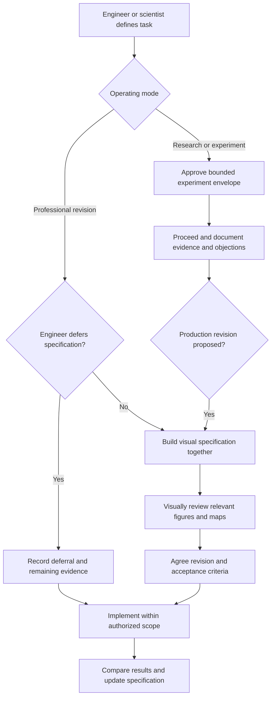

# Specification-first model revisions

## Cardinal rule and operating mode

For professional model revisions and production deliverables, work with the engineer or flood scientist to build a written specification before implementation. Save it as Markdown, HTML, or PDF in the authorized project location. This is the preferred professional workflow. The engineer may explicitly defer this step; record the deferral, scope, assumptions and remaining documentation in the task record, then proceed within existing authorization. Do not impose this process on a read-only question, ordinary software maintenance, or an unrelated deliverable.

A specification must include professional, report-quality figures and maps appropriate to the analysis, actually visually reviewed. A text-only change list or uninspected plot does not satisfy this requirement. Start with available baseline/site evidence and proposed-revision views; identify future result figures as planned rather than fabricating outputs. Update the specification with actual comparisons as work progresses.

For experimentation and research, use **proceed with approval and document**: agree on the question, experiment/change envelope, compute limits, expected evidence and consequential decision points; then proceed autonomously within that approval and maintain durable experiment records. Existing explicit task authorization can supply this approval. Do not request approval again for every routine reversible step. Approval of a research plan is not evidence that its hypothesis is correct or authorization to expand its scope. Return to the scientist for changes beyond the approved envelope and document decisions, failures and negative results. A production revision emerging from research returns to the specification workflow unless the engineer explicitly defers it.

## Build the specification with the responsible professional

Capture the intended engineering decision; source project and baseline identities; engine/package versions; requested model revisions and rationale; alternatives; affected plans, geometry, boundaries, terrain and classifications; units, CRS, vertical datum and time basis; data provenance and gaps; applicable HEC method references; assumptions and uncertainty; acceptance criteria; comparison design; outputs; authorized operations; and review/decision status. Identify which decisions remain with the engineer or scientist. Record revisions and departures from the agreed specification rather than silently changing it.

Use a figure register: figure ID, purpose and engineering question, source inputs/results, quantity/profile/event, units/datum/CRS/time basis, rendering settings, artifact path, caption, actual visual reviewer/date, findings and disposition. Automated checks complement visual inspection; they cannot stand in for it. If rendering or visual inspection is unavailable, mark the figure unreviewed and the specification incomplete; ask the professional to choose a review path or explicitly defer the step rather than claiming completion.

## Choose relevant figures and maps

Select a small set typical of the analysis, not every item below. Every included figure must support an engineering decision or verification.

| Analysis | Typical useful evidence |
|---|---|
| Boundary conditions and HMS integration | Domain/outlet/boundary-location map; aligned inflow/stage hydrographs; peaks, volumes and time coverage |
| Rainfall and meteorological forcing | Coverage/grid map; storm accumulation map; hyetographs and source-to-consumed-input comparisons |
| Terrain and geometry revisions | Site and modification-footprint maps; before/after profiles or sections; elevation-difference maps and affected structures |
| Land cover and infiltration | Classification/override maps; legends and parameter tables; final preprocessed-value or difference maps |
| Hydraulic scenarios and mapping | Comparable depth/WSE/velocity or relevant hazard maps; difference maps; profiles and time series at decision locations |
| Consequences | Hazard and exposure-coverage maps; clearly scoped event/alternative damage summaries; coverage and uncertainty figures |
| Research and performance | Baseline/control comparisons; sensitivity and residual figures; uncertainty evidence when actually computed; phase/end-to-end benchmarks for optimization |

Use readable typography at the intended report size, clear labels and units, meaningful legends/color scales, event/plan/time labels, source attribution and explanatory captions. Maps need spatial context and scale/orientation where useful. Compare equivalent quantities and use consistent extents/scales when comparison is intended; label deliberate differences. Distinguish WSE from depth, dry zero from missing/outside data, and illustrative settings from observed results. Inspect exports for clipping, overlap, unreadable legends, misleading masks, missing layers and incorrect geographic placement. Scientific interpretation and professional adequacy remain separate from presentation quality.

## Rich map reporting with ras2cng

Use ras2cng when its supported exports and map delivery improve the specification or report. Route through `ras-cloud-native-export` or `cloud-native-gis`, discover the installed canonical ras2cng contract, and retain source/result identity, quantity, profile/event, CRS/datum/units and time aggregation. ras2cng packaging does not replace hydraulic validation, map-quantity checks or actual visual review. Preserve source projects; no automatic upload or publication follows local map creation.

Interactive HTML maps can complement static figures, with explicit layers, legends and scenario labels. Markdown/PDF deliverables need legible static views or exports for the decisions they document; a link to an interactive map alone is insufficient. Check the final selected format: visible images and working references in Markdown, loading/layer behavior in HTML, and page-size legibility in PDF. Report the actual reviews performed and any deferred checks.

