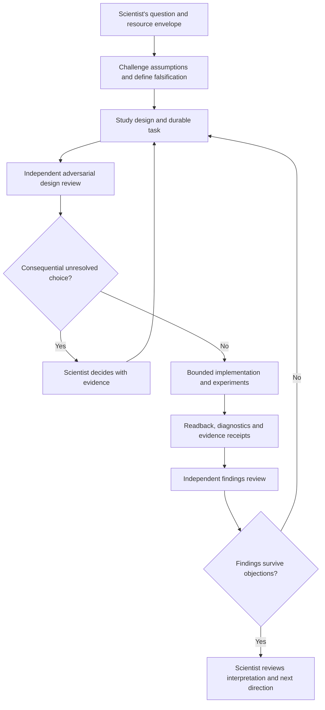
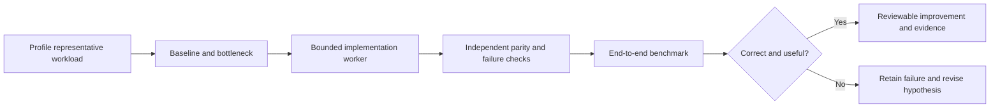

# Adversarial research and method improvement

## Grill the Flood Scientist

Begin with the scientist's intended decision, competing hypotheses, and the strongest plausible reason the proposed study could mislead them. Explain what evidence would change the conclusion. Distinguish an exploratory screen from a confirmatory experiment. Challenge the baseline before spending a large compute budget.

The diagram is a decision lifecycle, not an instruction to ask permission for every reversible step. Work independently inside the agreed envelope. A worker that cannot spawn reviewers reports that limitation rather than fabricating an independent review.

## Review packets and dispositions

Give the reviewer the question, baseline, source provenance, scenario design, observations, metrics, methods/versions, actual logs, failures and output paths. Keep the review bounded to relevant evidence. Seek alternative explanations for a claimed effect and checks for leakage, selective event choice, timestep/mesh confounding, datum/time offsets, conservation/stability problems, inappropriate loss application, and unsupported extrapolation.

Use a separate review result file with: objection; evidence/location; severity and scientific consequence; proposed discriminating test; response; new evidence; disposition (resolved, accepted limitation, rejected with evidence, or awaiting scientist). The coordinator owns the objection ledger. No silent deletion of negative findings. Escalate unresolved consequential interpretation to the scientist; do not label a finding validated solely because a reviewer agreed.

## Performance and Rust experiments

Record workload size, data identity, hardware, thread/memory settings, cold/warm conditions, compiler/package versions, and phase timings. Declare quantity-specific tolerances before comparisons. Cover wet/dry masks, nodata, CRS/units, time semantics, indexing, numerical edge cases, and public API behavior as relevant. Separate exact-preservation requirements from justified floating-point tolerances. A rewrite must not remove meaningful diagnostics or silently fall back to a different method.

Self-improvement means scoped, reviewable changes to methods, scripts or skills based on measured failures and benefits. It does not mean modifying unrelated agent policy, installing unreviewed external tools, changing shared environments, or expanding the research mandate. Preserve user pins and source models; leave a reproducible diff and experiment record for the scientist.
