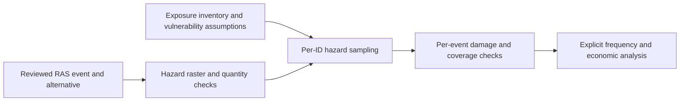

# RAS consequences analysis

Own the hazard-to-exposure and event-damage handoff. RAS Commander owns hydraulic project inspection/execution and map generation; `ras-mapping` and `ras-cloud-native-export` can prepare suitable outputs. The consequences engine consumes validated hazards and inventories; keep its implementation separate from RAS Commander.

Read [method and compatibility references](references/method-evidence.md) during planning. Establish the selected consequences engine, public upstream versus an authorized downstream build, exact version/commit or image digest, supported formats and available runtime. Do not assume a private downstream, Python binding, container or specialized raster sampler is available. Discover its current canonical help/config contracts and repository guidance before constructing a run.

## Plan the analysis

Record event, frequency provenance, alternative/condition, hydraulic result identity and aggregation, exposure vintage and IDs, occupancy mapping, valuation basis/currency year, foundation or first-floor convention, vulnerability functions and uncertainty mode. Select the actual project methodology before computing. Rainfall AEP is not automatically the flood-event AEP. Life-loss, indirect loss and agriculture require their own data and engine qualification; economic depth damage is not evidence for them.

For go-consequences depth workflows, provide depth above compatible ground, not WSE mislabeled as depth. Document horizontal CRS, vertical datum, depth units, raster resolution/aggregation, NoData and sampling method. Foundation height is first-floor elevation minus compatible ground elevation; the engine's depth reference and foundation adjustment must agree so the adjustment is not applied twice. Do not assume missing foundations, occupancy or valuations have harmless defaults.

## Prepare, execute, and verify

1. Use public RAS Commander paths/results/map APIs to locate and prepare the authorized hazard. Preserve the source model and result identity. Do not run a hydraulic model or regenerate maps merely to inventory available outputs; no direct `Ras.exe` calls.
2. Inspect the selected consequences provider's accepted raster/inventory schema, CRS transformation, quantity/units, compression/NoData and hazard-parameter requirements. A readable TIFF, COG, GeoParquet or PMTiles artifact is not automatically a supported analytical input. A horizontal transformation does not transform depth units or vertical datum.
3. Preserve stable receptor IDs and source inventory. Validate geometry, duplicates, occupancy coverage, valuation fields and foundation assumptions before sampling. Keep valid dry zero depths distinct from outside/missing cells. Reconcile counts for valid wet, valid dry, NoData, outside and rejected records.
4. Run only the authorized engine/config into a new output destination. Record the executable/image identity, input hashes, configuration, uncertainty mode and random seed when applicable. Inspect completion and parse the complete output; a zero exit or empty file does not establish success.
5. Reconcile per-ID depths, structure/content damage and event/condition totals. Check representative dry/wet/edge receptors independently and compare changed samplers or builds against a known baseline. Confirm output freshness, coordinate CRS, counts and absence of partial records.
6. Report event damage separately from expected annual damage, benefits or present value. Frequency integration, endpoint/tail treatment, damage monotonicity, discount rate, analysis years and uncertainty require explicit project assumptions and a qualified analysis method; do not invent them from a set of event files.

Return the event/alternative manifest, input/output paths and identities, coverage reconciliation, per-event totals, method assumptions and limitations. Separate hydraulic uncertainty, sampling/coverage uncertainty, inventory uncertainty and vulnerability uncertainty. A successful software run is not economic approval or a prediction of individual losses.
