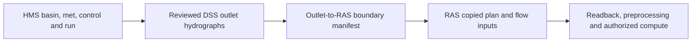

# HMS-to-RAS integration

**Cardinal rule:** For professional model revisions, build the specification with the engineer/scientist, including report-quality, relevant figures/maps that are actually visually reviewed; the engineer may explicitly defer it. For research, **proceed with approval and document** within the agreed envelope. Follow the [shared specification and reporting workflow](../../references/model-revisions/specification.md), using ras2cng for rich maps when useful. Existing authorization remains valid; do not repeat routine approval requests.

Own the hydrologic-to-hydraulic handoff. Use the installed `hms-commander` package and its canonical guidance for HMS model discovery, editing, execution, and results; use RAS Commander for RAS. Keep their project objects and API layers separate. A coupled forecast is not implicit authorization to run both engines.

Read [handoff evidence](references/handoff-evidence.md) for real notebook scope and package references. During planning, select the HMS and RAS boundary topics in [HEC planning references](https://github.com/gpt-cmdr/ras-commander/blob/main/docs/development/hec-planning-references.md), with manuals matching the engines in use.

## Inspect and plan the coupling

Discover installed package versions and public signatures, engine versions, project identities, available DSS backends, and actual source/output files. Locate canonical HMS guidance through the current package/repository; do not assume a separately installed `hms-commander` skill exists. Preserve pins and source projects. Initialize HMS from its `.hms` project, RAS from its project through their public APIs; use explicit project objects where multiple projects coexist.

Build a handoff manifest: HMS run/basin/met/control and element ID; DSS file plus exact pathname; quantity and units; model clock/timezone, interval convention, time window and missing values; RAS project/plan/unsteady owner and exact boundary selector. Review outlet location, contributing area and network routing. Distinguish total outlet flow from incremental lateral flow; avoid counting the same upstream runoff twice. Existing RAS rain-on-grid may also overlap the HMS contribution and must be an explicit modeling decision.

## Prepare and validate

1. Use current HMS APIs to inspect/clone/configure the authorized run. When execution is requested, use its supported execution API and verify completion plus actual new DSS output. Do not treat stale output from another run as the requested result.
2. Inspect DSS through the installed public HMS/RAS DSS APIs. Check the exact element, scenario, record type, units, finite coverage, hydrograph peak/time/volume and full RAS simulation/warmup interval. Convert units explicitly. Preserve volume and extrema appropriately when resampling; declare interpolation and gap policies rather than silently extending flow.
3. Match outlets to physically corresponding RAS boundaries. Catalog matching and correlation rank candidates; correlation does not prove correct catchment, scenario or spatial linkage. Preserve zero-lag comparisons separately from any diagnostic time shift.
4. Use `ras-boundary-conditions` for public RAS inline/DSS attachment on a working copy. Read back the actual owner, selected plan dependency, values, QMult/QMin and initial conditions. Preserve other boundaries, gates and meteorology.
5. If authorized, preprocess/compute RAS through `RasPreprocess`/`RasCmdr` and inspect model-consumed boundary inputs, output hydrographs and runtime diagnostics. Keep saved-input, preprocessing and solver evidence distinct; run completion does not establish forecast skill or calibration.

Return the manifest, versions, source/output provenance, hydrograph comparison and volume checks, changed artifacts and unresolved model assumptions. Missing HMS, DSS or engine capability is a blocker for its dependent step, not permission to reimplement parsers or invoke raw `Ras.exe`.
