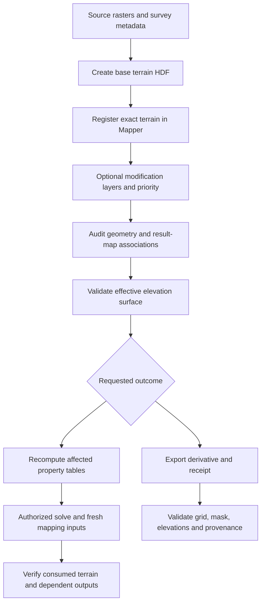

# Terrain workflow evidence

Read only the references relevant to the selected operation. Notebook code and retained output illustrate qualified fixtures; they do not establish support for the installed release or acceptance of the user's model.

The derivative branch does not itself change the project's geometry association. The compute branch requires the selected geometry to reference the intended terrain and regenerated dependencies.

## Create and associate base terrain

[Terrain creation notebook 920](https://github.com/gpt-cmdr/ras-commander/blob/main/examples/920_terrain_creation.ipynb) starts with a real extracted project, derives bounds, optionally retrieves USGS 3DEP tiles through `Usgs3depAws`, mosaics sources, and calls `RasTerrain.create_terrain_hdf()`. Its channel-over-base example passes the channel raster first to give it overlap priority; it does not create missing bathymetry. The notebook then registers terrain with `RasMap.add_terrain_layer()`, inventories fresh Mapper readback, and explicitly associates the terrain with geometry. Reuse these as separate acceptance steps. Its optional fallback to existing terrain is a demonstration convenience; report a failed requested creation rather than silently returning another surface as success.

[Terrain API documentation](https://github.com/gpt-cmdr/ras-commander/blob/main/docs/api/terrain.md) distinguishes `create_terrain_hdf`, `create_terrain_from_rasters`, registered-terrain export, and profile/volume analysis. Exact signatures, availability and runtime requirements belong to the installed API. Source-order stitching, projection assignment and vertical units affect the surface; recording only a terrain filename is insufficient provenance.

## Author and verify modifications

[Modification notebook 316](https://github.com/gpt-cmdr/ras-commander/blob/main/examples/316_terrain_modifications.ipynb) uses isolated existing/proposed Bald Eagle copies, high-ground lines and polygon grading, then native surface comparisons. [Layer-writer notebook 321](https://github.com/gpt-cmdr/ras-commander/blob/main/examples/321_terrain_modification_layer_writers.ipynb) writes line, constant-polygon and ellipse layers, round-trips supported layer representations, and compares complete native-export pixels and nodata masks. It checks each layer's rule against unmodified terrain rather than accepting an HDF write as surface validation.

Preserve these distinctions:

- High ground uses TakeHigher, channels use TakeLower, and a fill/set-value surface has different elevation semantics. A channel `depth` is below terrain sampled at its vertices; `elevation`, profile points, or line Z specify an absolute invert. Record which meaning the requested value has.
- Ground-line `System Name` is normally empty. A named system selects a different native joined-system behavior and can change the footprint at bends. Only set one for an intended joined system.
- New layers normally receive top priority (0). Resolve overlapping edits explicitly; changing insertion order can change the resulting terrain.
- HDF modifications need the Mapper terrain's `ElevationModificationGroup` named exactly `Modifications` to apply on the documented native routes. Readback of HDF alone does not demonstrate activation. Preserve enable flags and inspect warnings when adopting existing terrain.
- Polygon methods include constant elevation, vertex-Z, terrain-sampled boundaries and supplied perimeter/interior controls. Select only supported topology and method combinations from installed documentation; do not infer that a writer or subset copier supports every native polygon form.

[Modification analysis notebook 930](https://github.com/gpt-cmdr/ras-commander/blob/main/examples/930_terrain_modification_analysis.ipynb) creates an explicit channel modification and compares profiles and elevation-volume curves. Each existing/proposed condition uses its own geometry HDF because geometry association influences terrain selection. `RasTerrainMod` is suitable for focused native analytical samples; production raster export uses the registered-terrain API.

## Export the effective registered terrain

[Native export notebook 931](https://github.com/gpt-cmdr/ras-commander/blob/main/examples/931_native_rasmapper_terrain_export.ipynb) selects exactly one terrain from `RasMap.list_terrain_layers()`, exports a bounded Muncie two-source terrain, and inspects the typed result, source inventory, snapped grid and receipt. It re-inventories Mapper afterward to prove that exporting the derivative did not register or mutate the source terrain.

The documented route preserves native source priority, stitches, masks and optional modification rasterization. Downsample factors are restricted to 1, 2, 4 or 8; requested bounds snap outward to the source grid. Do not replace that grid with a rounded nominal resolution. Keep `rasterize_modifications` explicit when comparing baseline and proposed surfaces.

Read the current version matrix before running. At the reviewed source state, 6.3/6.3.1 lack the required bounded native contract; 6.4.0 and 7.0.0 are rejected for documented elevation/modification defects. Supported export releases and their Windows/Wine qualification differ; 7.0.2 has narrower qualified scope than 7.0.1, and forward-open 7.1 discovery is not numerical qualification. Do not hardcode this snapshot as a lasting compatibility policy.

A successful result requires a validated raster and promoted receipt. Inspect failed results' `failure_kind` and helper records. A confirmed empty extent may use the documented nodata option; an unconfirmed native failure must not be replaced with an invented empty raster. `compute_modified_terrain_raster()` is deprecated and numerically different, so it is not an export fallback.

## Associations, subsets and stale dependencies

[Terrain-input subset guidance](https://github.com/gpt-cmdr/ras-commander/blob/main/docs/terrain-input-subsets.md) documents export-only sampling Mapper copies, asset relocation in owned clones, and `RasMap.audit_terrain_associations()`. The audit checks terrain/classification/projection links and stale result-map terrain names without changing coordinates. Run it after moving a portable bundle, not only at its original location.

Subset workflows must retain complete supported modification records, original grid phase and required support beyond a requested AOI. Unsupported polygon layouts fail rather than being truncated or approximated. Do not import diagnostic subset support into an ordinary production promise.

After edits, distinguish surface validation from recomputation: an updated terrain sidecar does not prove existing property tables or hydraulic outputs used it. Keep a dependency record linking terrain, geometry, plan and mapping preparation; regenerate only the affected authorized stages and report any pending stage. Use the [HEC planning references](https://github.com/gpt-cmdr/ras-commander/blob/main/docs/development/hec-planning-references.md) for version-specific terrain, modification and geometry-preprocessing semantics.
