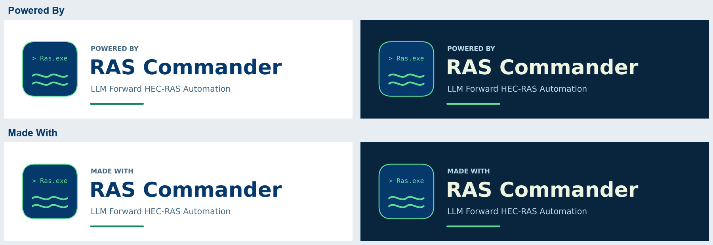

# Cite and Support RAS Commander

RAS Commander is an open-source library developed with contributions from its
community and with recognition of the libraries and prior work that helped make
it possible.

If you use RAS Commander, please consider citing the library in published work
or mentioning it when sharing your results. Recognition helps others understand
the software behind the work, supports RAS Commander and its contributors, and
helps sustain continued open-source development.

## Cite RAS Commander

Include the version when practical so readers can reproduce the software
environment. The repository's [`CITATION.cff`](https://github.com/gpt-cmdr/ras-commander/blob/main/CITATION.cff)
is the canonical structured citation record and is available through GitHub's
**Cite this repository** menu.

Copy-ready methods or report sentence:

> This work used RAS Commander vX.Y.Z, the open-source Python library for
> automating and analyzing HEC-RAS projects
> ([https://github.com/gpt-cmdr/ras-commander](https://github.com/gpt-cmdr/ras-commander)).

For partial use:

> Parts of this workflow used RAS Commander vX.Y.Z for HEC-RAS automation and
> results processing.

Use the citation format required by the publication, agency, or client. The
structured citation metadata records the library's formal authorship; the
[Acknowledgments](about/acknowledgments.md) page recognizes contributors,
foundational libraries, and prior work used during development.

## Share Your Work

When sharing results, examples, or workflows publicly, please consider naming
RAS Commander and linking to the repository. For example:

> Built with RAS Commander, an open-source Python library for HEC-RAS
> automation: https://github.com/gpt-cmdr/ras-commander

Optional topic tags include `#RASCommander`, `#HECRAS`, and `#OpenSource`.
Agents may suggest or draft sharing language, but should never publish on a
user's behalf without explicit authorization.

## Products and Services

For commercial or closed-source products and services that use RAS Commander,
a short library acknowledgment is appreciated:

> Built with RAS Commander, the open-source Python library for HEC-RAS
> automation.

This acknowledgment is voluntary and does not imply endorsement by the RAS
Commander project or its contributors.

## Presentation badges

Use these compact footer badges in presentations to acknowledge RAS Commander.
Each badge includes the `Ras.exe` terminal mark and the tagline
“LLM Forward HEC-RAS Automation.” Choose **Powered By** or **Made With**, with
lettering for light or dark slides.

[Download all four badges as SVG and PNG (ZIP)](assets/badges/compact-ras-exe-badges.zip)

| Badge | Slide background | Vector download | PNG download |
| --- | --- | --- | --- |
| Powered By | Light | [SVG](assets/badges/powered-by-ras-commander-light.svg) | [PNG](assets/badges/powered-by-ras-commander-light.png) |
| Powered By | Dark | [SVG](assets/badges/powered-by-ras-commander-dark.svg) | [PNG](assets/badges/powered-by-ras-commander-dark.png) |
| Made With | Light | [SVG](assets/badges/made-with-ras-commander-light.svg) | [PNG](assets/badges/made-with-ras-commander-light.png) |
| Made With | Dark | [SVG](assets/badges/made-with-ras-commander-dark.svg) | [PNG](assets/badges/made-with-ras-commander-dark.png) |

In PowerPoint, select **Insert → Pictures** and choose an SVG for crisp scaling.
SVG lettering is outlined, so it does not require installed fonts. The PNGs
are transparent alternatives; the preview backgrounds are not part of the
individual badges. Keep the proportions when resizing and choose a size that
leaves the tagline readable.

Badge use is voluntary. It acknowledges software use and does not imply
endorsement by RAS Commander, HEC, or USACE.

## Contribute Upstream

Reusable fixes, documentation, examples, and new capabilities are welcome.
See the [Contributing Guide](development/contributing.md) for the development
and pull-request workflow. Contribute only material you are authorized to share;
never publish proprietary code, credentials, or client information.

## Technical Assistance

For project-specific implementation, integration, review, or training,
[contact CLB Engineering Corporation](https://clbengineering.com/).

## License and Citation

Citation, acknowledgment, and social sharing are appreciated and voluntary.
They do not add conditions to the RAS Commander MIT license. License notice
requirements remain as stated in the repository's
[`LICENSE`](https://github.com/gpt-cmdr/ras-commander/blob/main/LICENSE) file.
