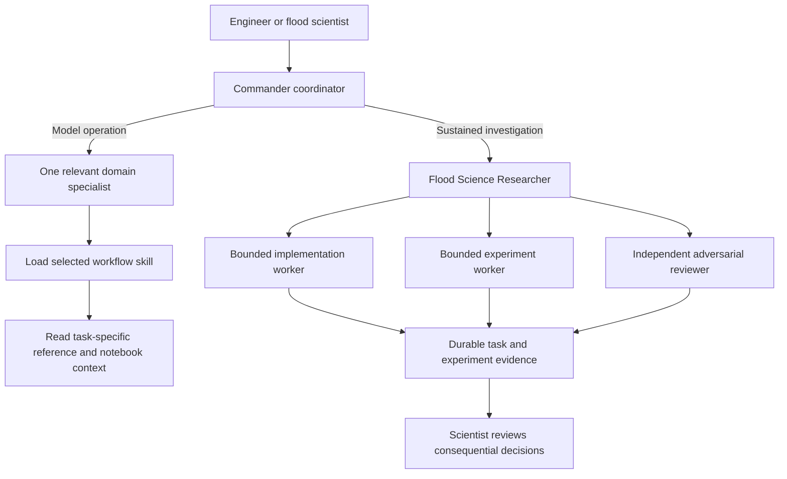
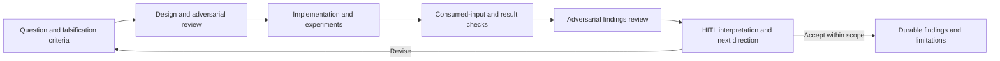

# Cognitive Infrastructure

This section documents ras-commander's **AI-assisted development infrastructure** - a comprehensive system of agents, skills, and commands that enable sophisticated LLM-powered workflows for HEC-RAS automation.

## Philosophy: LLM Forward Development

The cognitive infrastructure embodies the **LLM Forward** engineering philosophy:

1. **Professional Responsibility First** - Public safety, ethics, and licensure remain paramount
2. **LLMs Forward (Not First)** - Technology accelerates engineering insight without replacing judgment
3. **Multi-Level Verifiability** - HEC-RAS projects (GUI review) + visual outputs + code audit trails
4. **Human-in-the-Loop** - Multiple review pathways for professional engineering oversight

## Cardinal rule: specification-first revisions

For professional model revisions and production deliverables, develop a Markdown, HTML, or PDF specification with the engineer or flood scientist before implementation. Include relevant, report-quality figures and maps that have actually been visually reviewed. The engineer can explicitly defer this preferred step; record that choice. Use ras2cng when it helps produce rich maps, with static views appropriate to Markdown/PDF and checked layer behavior in HTML.

For experimentation and research, **proceed with approval and document**: agree on a bounded research envelope, then act within it and preserve decisions, experiments and visual evidence. Existing approval covers routine work inside that envelope. A proposed production revision returns to specification-first work unless explicitly deferred.

## Routing without context overload



The coordinator selects responsibilities rather than loading every procedure. Specialists read the relevant skill, then only the references needed for their task. They return bounded findings and artifact paths rather than raw grids, full notebooks, or large logs.

## Capability-focused specialists

Start with the shared RAS Commander coordinator, then select the workflow needed for the requested model operation. Roles describe responsibilities; model selection depends on the active provider and task.

| Workflow | Responsibility | Evidence returned |
|---|---|---|
| Boundary conditions | Boundary/initial conditions and DSS assignments | Units, timing, coverage, assignments and readback |
| Meteorological forcings | Native DSS/Vortex capability selection and conversion | Variable semantics, grid metadata and record checks |
| Gridded precipitation | Historical/design rainfall preparation and plan attachment | Totals, timing, coverage and consumed-input checks |
| Mapping | Hydraulic map generation and fast-map comparison | Quantity, terrain, CRS, wet/dry treatment and parity limits |
| Land surface | Land use/roughness and soils/infiltration | Classification coverage, overrides and preprocessed values |
| Cloud-native export | ras2cng conversion and delivery | Provenance, quantity semantics and output validation |
| Terrain | Terrain creation, modifications and geometry association | Elevation/datum checks, changed footprint and dependent regeneration |
| HMS integration | hms-commander watershed-to-hydrograph handoff | Model identity, boundary matching, units, timing and readback |
| Consequences | RAS results to go-consequences analysis | Hydraulic/exposure compatibility, event assumptions and loss uncertainty |

Consult the [HEC planning references](../development/hec-planning-references.md) for the applicable engine version and method before choosing settings. Shared skills contain the workflows and notebook references; Claude agents are thin adapters, and Codex uses the same skill sources.

Model names checked in T3 Code on November 17, 2026: Claude Opus, Sonnet, and Haiku **5.5**; Codex **GPT-6.1 Sol**, **GPT-6.1 Terra**, **GPT-6 Astra**, and **GPT-6 Luna**. Availability and reasoning settings depend on the configured provider; these names do not prescribe a fixed model for each role.

## Long-running flood-science research

The research coordinator supports hydraulic/numerical, hydrometeorological, and inundation-map investigations. Its default **Grill the Flood Scientist** posture challenges assumptions, seeks disconfirming evidence, and uses independent adversarial design and findings reviews. The scientist sets direction and resolves consequential choices; the agent takes initiative within the agreed research and resource envelope. It defines hypotheses and controlled comparisons, delegates bounded implementation and experiment tasks, and maintains durable `TASK.md`, `STATE.md`, `PROGRESS.md`, and experiment receipts. Resume from those records and verified artifacts rather than conversation memory.

The shared [flood-science-research skill](https://github.com/gpt-cmdr/ras-commander/blob/main/.claude/skills/flood-science-research/SKILL.md) includes a task template and notebook references covering calibration, roughness/mesh sensitivity, uncertainty preparation, and event comparisons. Saved notebook outputs have specific limits: a sampling recipe is not a completed ensemble, and a gauge comparison with unmatched boundary histories is not calibration validation. Research findings must identify the tested inputs, observations, versions and unresolved uncertainty.



Method improvement can include Rust rewrites when profiling identifies a relevant bottleneck. Preserve the original method as an oracle, establish semantic/numerical parity, and benchmark end-to-end performance before proposing adoption. Speed alone does not establish scientific validity.

## Further capability work

The [commit-based capability roadmap](../development/capability-agent-roadmap.md) assesses recent development and separates proposed roles from implemented workflows. Priorities include geometry/mesh preparation and hydraulic structures; subdomain breakout is initially a focused skill under hydraulic research. Existing execution roles should be reconciled before adding another coordinator. Floodway and sediment workflows can begin as specialized skills.

## Core Components

### Agents

**Subagents** are specialized AI assistants that handle specific HEC-RAS domains:

- **Domain Specialists** - HDF analysis, geometry parsing, USGS integration
- **Knowledge Management** - Hierarchical knowledge organization
- **Utility Agents** - Documentation, notebooks, environments
- **Review Agents** - Output auditing, anomaly detection

**Key Features:**
- Shared context through the `AGENTS.md` hierarchy and Claude loader files
- Model selection optimized for task type
- Markdown output persistence across sessions

### Skills

**Skills** are reusable workflow templates that guide common tasks:

- **Execution Skills** - Running HEC-RAS plans, parallel/remote execution
- **Extraction Skills** - HDF results, geometry parsing, DSS boundaries
- **Integration Skills** - USGS gauges, AORC precipitation
- **Repair Skills** - Geometry validation and automated fixes

**Key Features:**
- Lightweight navigators to primary documentation
- Copy-paste ready code examples
- Cross-references to example notebooks

### Commands

**Commands** are slash commands for multi-session task coordination:

- **Task Management** - `/agent-taskclose`, `/agent-taskupdate`
- **Agent Coordination** - `/agent-engagesubagents`
- **Repository Operations** - `/agent-crossrepo`, git worktree commands
- **Maintenance** - `/agent-cleanfiles`

**Key Features:**
- Persistent state across conversation sessions
- Knowledge extraction at session close
- Non-destructive file lifecycle (move to `.old/`, never delete)

## How It Works Together

### Context Inheritance

Read the applicable shared contracts in the selected worker context; harness loading differs, so do not assume that delegation transfers the full parent conversation:

```
Root AGENTS.md (shared project contract)
    ↓
ras_commander/AGENTS.md (library patterns)
    ↓
ras_commander/hdf/AGENTS.md (HDF implementation)
    ↓
Read applicable local contracts in the selected worker context
```

### Knowledge Persistence

Subagents write findings to markdown files, not ephemeral text:

```
Subagent performs work
    ↓
Writes to: .claude/outputs/{subagent}/{date}-{task}.md
    ↓
Returns file path to orchestrator
    ↓
Knowledge persists across sessions
```

### Multi-Session Coordination

For complex tasks spanning sessions:

```
agent_tasks/.agent/
├── STATE.md       # Current task state snapshot
├── PROGRESS.md    # Session history log
├── BACKLOG.md     # Remaining work items
└── NEXT_TASKS.md  # Immediate priorities
```

## Quick Reference

### Invoking Agents

```text
Task: inspect the selected plan's boundary forcing coverage
Allowed reads: named project and DSS paths
Allowed writes: worker-specific report path
Return: coverage gaps, units/time basis, versions, evidence locators
Do not execute or modify the model for this inspection
```

### Using Skills

Skills auto-load based on trigger phrases:

- "Execute HEC-RAS plan" → `hecras_compute_plans`
- "Extract HDF results" → `hecras_extract_results`
- "Parse geometry file" → `hecras_parse_geometry`

### Running Commands

```bash
# End-of-session knowledge extraction
/agent-taskclose

# Periodic file cleanup
/agent-cleanfiles

# Create isolated worktree for feature
/agents-start-gitworktree feature-name
```

## Directory Structure

```
.claude/
├── agents/           # Subagent definitions
│   ├── hdf-analyst/
│   ├── geometry-parser/
│   ├── usgs-integrator/
│   └── ...
├── skills/           # Workflow templates
│   ├── hecras_compute_plans/
│   ├── hecras_extract_results/
│   └── ...
├── commands/         # Slash commands
│   ├── agent-taskclose.md
│   ├── agent-cleanfiles.md
│   └── ...
├── rules/            # Auto-loaded guidance
│   ├── python/
│   ├── hec-ras/
│   └── ...
└── outputs/          # Subagent work products
```

## Benefits

### For Engineers

- **Accelerated Workflows** - AI assists with routine tasks
- **Quality Assurance** - Automated validation and review
- **Knowledge Capture** - Learnings persist across sessions
- **Multi-Level Review** - GUI + visual + code verification

### For Development

- **Cost Optimization** - Use cheaper models where appropriate
- **Parallel Execution** - Multiple agents work simultaneously
- **Clear Boundaries** - Each agent has defined scope
- **Audit Trail** - All work products traceable

## See Also

- [LLM Forward Development Philosophy](../development/llm-development.md)
- [Contributing Guide](../development/contributing.md)
- [Architecture Overview](../development/architecture.md)
