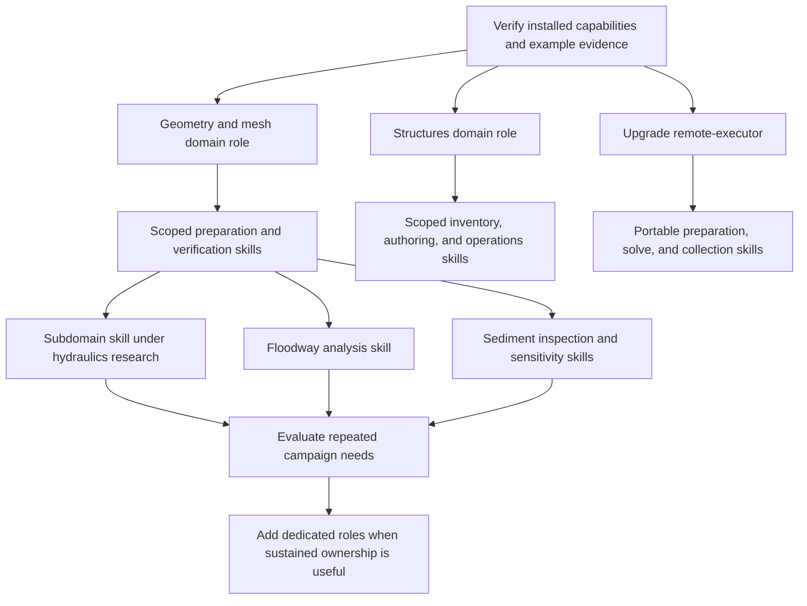

# Capability-agent roadmap

Recent development supports additional HEC-RAS workflows beyond boundary conditions, mapping, meteorological forcings, gridded precipitation, land surface, cloud-native export, research, terrain, HMS integration, and consequence analysis. This roadmap prioritizes the next additions. **These recommendations are proposed, not implemented by this assessment.**

The [shared agent architecture](multi-harness-agent-contract.md) governs portable skills and thin harness adapters. Use [HEC planning references](hec-planning-references.md) for version-specific methods and controls; use installed package contracts and qualified examples for executable capabilities.

## Evidence and review window

On November 17, 2026, the assessment queried the GitHub commits API for `gpt-cmdr/ras-commander` with `since=2026-08-17T00:00:00Z`, following every pagination link at 100 records per page. It returned **1,619 commit records**, with author dates spanning **August 22–November 16, 2026**. This is reachable repository history, including merges and branch commits, not 1,619 distinct features. The review screened commit subjects, inspected selected commit file lists, and checked relevant current source, release notes, and notebook source. It did not run hydraulic models or independently reproduce every result.

The local checkout was shallow; GitHub history supplied the assessment rather than treating the shallow log as a complete three-month record. Commit dates below are author dates. No adjacent-package release audit was performed. Merged changes and retained qualification evidence do not establish compatibility with every installed release, host, solver, or model. Before executing a proposed workflow, discover installed versions and public signatures and inspect the relevant example's actual scope.

## Priorities and ownership

| Priority | Proposed work | Agent or skill decision | Engineering boundary and expected evidence |
|---|---|---|---|
| 1 | Geometry, mesh, and preprocessing | Add a domain role with scoped skills for inspection, authored-geometry preparation, mesh generation/repair, and preprocessing verification. | Own geometry and mesh preparation, including breaklines/refinements and layer associations. Terrain supplies the surface; mapping consumes results. Verify the selected geometry, preserved features, compiled products, and final parameter values rather than accepting process completion alone. |
| 2 | Hydraulic structures and operations | Add a structures domain agent; keep bridge/culvert/weir, connection, gate, pipe, and pump procedures in task-specific skills. | Separate inventory/results inspection from authoring and operating-rule changes. Confirm native identities, coefficients, units, operating times, applicable hydraulic methods, and supported version-specific writes. |
| 3 | Portable execution and runtime qualification | Upgrade the existing `remote-executor` role and its execution skills rather than create a competing compute coordinator. | Own preparation versus solve stages, release/image selection, resource limits, isolated staging, receipts, completion checks, and result collection. Domain agents own physical inputs and interpretation. |
| 4 | Hydraulic subdomains and breakouts | Start with a skill routed through the hydraulics research workflow; promote to a dedicated role when repeated campaigns justify persistent domain ownership. | Own partition proposals, parent-derived inflows, boundary placement, tiered runs, and parent comparisons. Exact-cell extraction does not guarantee hydraulic equivalence; normal-depth assumptions and closed-edge treatment need explicit justification. |
| 5 | Floodway and encroachment | Start with a bounded analysis skill; add a specialist role when recurring studies require it. | Own base/encroached plan pairing, profile/station alignment, settings, rise calculations, and failure evidence. Computing a rise does not determine the governing regulatory criteria. |
| 6 | Sediment and morphodynamics | Start with result-inspection and sensitivity skills beneath research; introduce a dedicated role when method selection, calibration, and repeated mobile-bed studies warrant it. | Separate sediment-method and parameter assumptions from mesh/timestep effects and reader qualification. Preserve grain-class identity, unit systems, bed-change definitions, and event provenance. |

## Recent implementation evidence

### Geometry and mesh preparation

[September 19: headless mesh generation on HEC-RAS 6.0–6.5](https://github.com/gpt-cmdr/ras-commander/commit/ae298aea283750406ab8e62d0c55dac598d3053f) changed `GeomMesh`, its tests, and API documentation. [November 14: native reference-point replacement and removal](https://github.com/gpt-cmdr/ras-commander/commit/5cc153b63941b6a01ad78fb2758d5c6666008a20) added current editing coverage and regression checks. These are domain capabilities that a general geometry parser does not adequately describe.

The role should route a read-only mesh audit separately from regeneration or repair. Preparation skills should explain authored geometry versus compiled HDF products, selected-area identity, retained breaklines/refinements, feature associations, backups, and version-dependent preprocessing. They should invoke public RAS Commander APIs rather than raw HEC executables.

### Structures and operations

[October 21: qualified per-family 1D structure HDF layouts](https://github.com/gpt-cmdr/ras-commander/commit/12247e6deed5a77aed421f597f5aa02891414c3a) strengthened result extraction. [October 30: pump summaries from stored results](https://github.com/gpt-cmdr/ras-commander/commit/92a32267dc) addresses another operational domain.

Read [206: structures and metadata](https://github.com/gpt-cmdr/ras-commander/blob/main/examples/206_structures_and_metadata.ipynb) for inventory, [208: bridge method comparison](https://github.com/gpt-cmdr/ras-commander/blob/main/examples/208_bridge_method_comparison.ipynb) for method effects on computed WSE, and the authoring examples [209: culverts](https://github.com/gpt-cmdr/ras-commander/blob/main/examples/209_culvert_authoring.ipynb), [215: SA/2D bridge connections](https://github.com/gpt-cmdr/ras-commander/blob/main/examples/215_sa2d_bridge_connection_authoring.ipynb), [216: 1D bridges](https://github.com/gpt-cmdr/ras-commander/blob/main/examples/216_1d_bridge_authoring.ipynb), and [227: 2D connection culverts](https://github.com/gpt-cmdr/ras-commander/blob/main/examples/227_2d_connection_culvert_authoring.ipynb). [411: pipes and pumps](https://github.com/gpt-cmdr/ras-commander/blob/main/examples/411_2d_hdf_pipes_and_pumps.ipynb) supplies a result-inspection entry point. A notebook's presence does not qualify every structure family or authorize a project mutation.

### Portable execution

[October 13: Slurm arrays and contained Wine steps](https://github.com/gpt-cmdr/ras-commander/commit/0fe214dcce66359710848359b1cbcdc672021f91) changed `RasSlurm`, portable launchers, and execution tests. [October 22: portable bundles on node-local scratch](https://github.com/gpt-cmdr/ras-commander/commit/f0d2b80df1) further separates job staging from shared source projects.

Current release notes explicitly remove unimplemented SSH, WinRM, AWS, Azure, and Slurm worker stubs from `init_ras_worker`; supported worker labels and `RasSlurm`/`RasApptainer` workflows must not be conflated. Update existing remote-execution guidance to follow the actual APIs, preparation receipts, and host/runtime constraints. Do not resurrect unsupported worker names or advertise all historical runtimes as interchangeable.

### Hydraulic subdomains

[October 24: exact-cell subdomain authoring, validation, runs, and comparisons](https://github.com/gpt-cmdr/ras-commander/commit/ed4446a8a8d85800ea746ae3c7d9e7ecf335905d) introduced the full workflow in `RasSubdomain` and its tests. [October 25: parent-plan inflow selection](https://github.com/gpt-cmdr/ras-commander/commit/f83f326642) and [optional closed-edge normal-depth outflow](https://github.com/gpt-cmdr/ras-commander/commit/a52ff7ed1a) show why the workflow needs more than geometric clipping.

[237: hydraulic subdomain breakout](https://github.com/gpt-cmdr/ras-commander/blob/main/examples/237_hydraulic_subdomain_breakout.ipynb) demonstrates two Salt Draw subdomains and parent comparisons in HEC-RAS 6.4.1. Use its comparison design and documented limitations when creating the skill; do not generalize its outcome to arbitrary partitions, bidirectional exchanges, or metric models without current capability evidence.

### Floodway and encroachment

[October 22: floodway preflight and steady station reader](https://github.com/gpt-cmdr/ras-commander/commit/35ffe6c8670dc484061f048b9d8ea2b01f2ae8d9), [October 30: native encroachment/boundary/lateral-weir reads](https://github.com/gpt-cmdr/ras-commander/commit/e5de987764), and [October 30: blank Method 4/5 targets](https://github.com/gpt-cmdr/ras-commander/commit/d46aaf3cdc) support a focused skill for trustworthy plan comparison. Preserve missing values and rejected preflight conditions rather than presenting incomplete comparisons as valid floodway findings.

### Sediment and morphodynamics

[August 23: plan sediment and breach metadata](https://github.com/gpt-cmdr/ras-commander/commit/48c0f8633bd2049a94c815a9b0574cfec75dc9f9), [October 21: native sediment readers](https://github.com/gpt-cmdr/ras-commander/commit/f087e5a298), and [October 21: SI sediment units](https://github.com/gpt-cmdr/ras-commander/commit/a659cf887b) provide implementation anchors.

[230: Chippewa sediment mesh sensitivity](https://github.com/gpt-cmdr/ras-commander/blob/main/examples/230_mesh_sensitivity_analysis.ipynb) and [232: Weise flume sensitivity](https://github.com/gpt-cmdr/ras-commander/blob/main/examples/232_weise_2d_sediment_mesh_sensitivity.ipynb) supply contrasting example contexts for mesh changes, bed response, and unit-aware extraction. Their mechanics and retained observations do not establish general transport-function validity, calibration quality, or research conclusions beyond the demonstrated cases.

## Implementation sequence

Every addition should state its intake, allowed operations, installed-version checks, artifact ownership, and evidence required at handoff. Validate realistic routing and at least one representative workflow before advertising activation. New documentation alone establishes guidance availability, not demonstrated execution or model adequacy.
