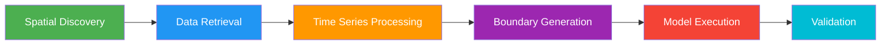

# USGS Gauge Data Retrieval

## Water Data migration scope

Core flow/stage retrieval, real-time readings, initial-condition observations,
and API-key checks use `dataretrieval.waterdata` and require
`dataretrieval>=1.4`. Public result columns remain unchanged. Approval status is
read separately from other qualifiers; missing approval, unexpected units, and
conflicting observations at one timestamp raise instead of silently selecting
an interpretation.

Queries use UTC: naive timestamps are interpreted as UTC, aware timestamps are
converted to UTC, and date-only end bounds include the entire UTC date. Daily
means use statistic `00003` and their returned date labels are represented at
UTC midnight. Legacy site-local calendar bounds can select different intervals;
check date boundaries and alignment when migrating existing studies. Use
explicit timezone-aware timestamps for precise continuous-data windows.

Spatial discovery uses modern monitoring locations and time-series metadata;
annual peak discharge uses the modern peaks collection. The USGS module no
longer calls the legacy site, instantaneous, daily or peak services. See the
[official USGS migration guide](https://api.waterdata.usgs.gov/docs/ogcapi/migration/)
for endpoint and field changes.


The USGS integration module retrieves gauge data and supports spatial discovery, boundary-condition generation, and model-validation workflows.

!!! tip "USGS API key"
    The modern services support an API key for higher request limits. Configure
    it through `API_USGS_PAT` using the existing USGS configuration helpers.
    See [USGS API-key registration](https://api.waterdata.usgs.gov/signup/)
    and the [provider's key documentation](https://api.waterdata.usgs.gov/docs/ogcapi/keys/).

## Overview

The USGS module supports the complete workflow from gauge discovery to model validation:



## Quick Start: Gauge Catalog

The **gauge catalog** feature is the fastest way to get started. It creates a standardized project folder with all gauge data for your model:

```python
from ras_commander.usgs import catalog

# One command: discover gauges, download data, organize project
catalog.generate_gauge_catalog(
    project_folder="C:/Projects/MyModel",
    buffer_miles=10.0,
    start_date="2020-01-01",
    end_date="2023-12-31"
)
```

This creates:
```
MyModel/
  USGS Gauge Data/
    gauge_catalog.csv           # Master catalog (site_id, location, drainage area)
    gauge_locations.geojson     # Spatial data for GIS mapping
    README.md                   # Documentation
    USGS-01646500/             # One folder per gauge
      metadata.json
      historical_flow.csv
      historical_stage.csv
```

**Benefits**:

- ✅ One-command project setup
- ✅ Engineering review of gauge data before modeling
- ✅ Reproducible workflows
- ✅ Standard project organization

## Spatial Discovery

Find gauges within your model domain:

```python
from ras_commander.usgs import UsgsGaugeSpatial

# Find all active gauges within 5 miles of project bounds
gauges = UsgsGaugeSpatial.find_gauges_in_project(
    project_folder="C:/Projects/Potomac",
    buffer_miles=5.0
)

# Returns GeoDataFrame with gauge locations and metadata
print(gauges[['site_no', 'station_name', 'drain_area_sq_mi']])
```

**Find gauges near a specific point**:
```python
gauges = UsgsGaugeSpatial.find_gauges_near_point(
    latitude=38.9497,
    longitude=-77.4563,
    radius_miles=10.0
)
```

**Filter by data availability**:
```python
# Only gauges with data for simulation period
active_gauges = UsgsGaugeSpatial.get_project_gauges_with_data(
    project_folder="C:/Projects/Potomac",
    start_date="2023-01-01",
    end_date="2023-12-31",
    parameter="flow"  # or "stage"
)
```

## Data Retrieval

### Flow Data

```python
from ras_commander.usgs import RasUsgsCore

# Retrieve instantaneous flow data (15-minute or hourly)
flow_data = RasUsgsCore.retrieve_flow_data(
    site_no="01646500",
    start_date="2023-06-01",
    end_date="2023-08-31",
    service="iv"  # Instantaneous values
)

# Retrieve daily values (for longer periods)
daily_flow = RasUsgsCore.retrieve_flow_data(
    site_no="01646500",
    start_date="2020-01-01",
    end_date="2023-12-31",
    service="dv"  # Daily values
)
```

### Stage Data

```python
# Retrieve stage/water surface elevation data
stage_data = RasUsgsCore.retrieve_stage_data(
    site_no="01646500",
    start_date="2023-06-01",
    end_date="2023-08-31"
)
```

### Gauge Metadata

```python
# Get gauge information
metadata = RasUsgsCore.get_gauge_metadata(site_no="01646500")

print(f"Station: {metadata['station_name']}")
print(f"Drainage Area: {metadata['drain_area_sq_mi']} sq mi")
print(f"Location: {metadata['dec_lat_va']}, {metadata['dec_long_va']}")
```

## Gauge Matching

Associate USGS gauges with HEC-RAS model features:

```python
from ras_commander.usgs import GaugeMatcher

# Automatic matching to cross sections or 2D areas
matches = GaugeMatcher.auto_match_gauges(
    gauges_gdf=gauges,
    project_folder="C:/Projects/Potomac"
)

# Manual match to specific cross section
match_info = GaugeMatcher.match_gauge_to_cross_section(
    site_no="01646500",
    river="Potomac River",
    reach="Main",
    rs="10.5",
    project_folder="C:/Projects/Potomac"
)

# Assess matching confidence
confidence = GaugeMatcher.get_matching_confidence(match_info)
```

**Matching criteria**:

- ✓ Spatial proximity to cross section or 2D area
- ✓ Drainage area comparison (gauge vs upstream area)
- ✓ River/reach name matching

## Time Series Processing

Prepare USGS data for HEC-RAS compatibility:

### Resampling

```python
from ras_commander.usgs import RasUsgsTimeSeries

# Resample to HEC-RAS computational interval
resampled = RasUsgsTimeSeries.resample_to_hecras_interval(
    flow_data,
    interval="15MIN"  # Options: 15MIN, 1HOUR, 1DAY
)
```

### Gap Detection and Filling

```python
# Check for data gaps
gaps = RasUsgsTimeSeries.check_data_gaps(flow_data)
if gaps:
    print(f"Found {len(gaps)} data gaps")

# Fill gaps (interpolation or extrapolation)
filled_data = RasUsgsTimeSeries.fill_data_gaps(
    flow_data,
    method="linear"  # or "forward", "backward"
)
```

### Extract Simulation Period

```python
# Extract data matching HEC-RAS simulation window
sim_data = RasUsgsTimeSeries.extract_simulation_period(
    flow_data,
    start_datetime="2023-06-15 00:00",
    end_datetime="2023-06-20 00:00"
)
```

## Boundary Condition Generation

Generate HEC-RAS boundary condition tables from USGS data:

```python
from ras_commander.usgs import RasUsgsBoundaryGeneration

# Generate flow hydrograph table (HEC-RAS fixed-width format)
bc_table = RasUsgsBoundaryGeneration.generate_flow_hydrograph_table(
    flow_data=resampled,
    river="Potomac River",
    reach="Main",
    rs="100.0"
)

# Insert into unsteady flow file
from ras_commander import RasUnsteady

RasUsgsBoundaryGeneration.update_boundary_hydrograph(
    unsteady_file="C:/Projects/Potomac/Potomac.u01",
    bc_table=bc_table,
    bc_line_number=15  # Line number of existing boundary
)
```

**Stage boundary conditions**:
```python
# Generate stage hydrograph (for downstream boundaries)
stage_bc = RasUsgsBoundaryGeneration.generate_stage_hydrograph_table(
    stage_data=stage_resampled,
    river="Potomac River",
    reach="Main",
    rs="0.5"
)
```

## Initial Conditions

Extract initial condition values from USGS data:

```python
from ras_commander.usgs import InitialConditions

# Get IC value at simulation start time
ic_value = InitialConditions.get_ic_value_from_usgs(
    flow_data,
    start_datetime="2023-06-15 00:00"
)

# Generate properly formatted IC line
ic_line = InitialConditions.create_ic_line(
    river="Potomac River",
    reach="Main",
    rs="100.0",
    ic_value=ic_value,
    ic_type="flow"  # or "stage"
)

# Update unsteady file
InitialConditions.update_initial_conditions(
    unsteady_file="Potomac.u01",
    ic_line=ic_line
)
```

## Real-Time Monitoring

Access real-time gauge data for operational forecasting:

```python
from ras_commander.usgs import RasUsgsRealTime

# Get latest gauge reading (updated hourly by USGS)
latest = RasUsgsRealTime.get_latest_value(
    site_no="01646500",
    parameter="flow"
)
print(f"Current flow: {latest['value']} {latest['unit']}")

# Get recent data for trend analysis
recent = RasUsgsRealTime.get_recent_data(
    site_no="01646500",
    hours=24,
    parameter="flow"
)

# Detect threshold crossing (flood stage)
is_flooding = RasUsgsRealTime.detect_threshold_crossing(
    site_no="01646500",
    threshold=50000,  # cfs
    parameter="flow"
)

# Detect rapid changes (flash flood conditions)
rapid_rise = RasUsgsRealTime.detect_rapid_change(
    site_no="01646500",
    rate_threshold=5000,  # cfs/hour
    parameter="flow"
)
```

### Continuous Monitoring

```python
# Monitor gauge with callback alerts
def flood_alert(site_no, value, threshold):
    print(f"ALERT: {site_no} exceeded {threshold}: {value} cfs")
    # Trigger automated model run, send notification, etc.

RasUsgsRealTime.monitor_gauge(
    site_no="01646500",
    threshold=50000,
    callback=flood_alert,
    interval_minutes=15
)
```

## Model Validation

Compare HEC-RAS results to observed gauge data:

### Extract Modeled Results

```python
from ras_commander import HdfResultsXsec

# Extract modeled flow at gauge location
modeled_flow = HdfResultsXsec.get_xsec_timeseries(
    "01",
    river="Potomac River",
    reach="Main",
    rs="10.5",
    variables=["Flow"]
)
```

### Calculate Validation Metrics

```python
from ras_commander.usgs import metrics

# Align time series (handles different intervals/timestamps)
from ras_commander.usgs import RasUsgsTimeSeries
aligned_obs, aligned_mod = RasUsgsTimeSeries.align_timeseries(
    flow_data, modeled_flow
)

# Nash-Sutcliffe Efficiency (NSE)
nse = metrics.nash_sutcliffe_efficiency(aligned_obs, aligned_mod)
print(f"NSE: {nse:.3f}")  # Perfect = 1.0, > 0.5 is acceptable

# Kling-Gupta Efficiency (KGE)
kge_result = metrics.kling_gupta_efficiency(aligned_obs, aligned_mod)
print(f"KGE: {kge_result['kge']:.3f}")  # Perfect = 1.0
print(f"  Correlation: {kge_result['r']:.3f}")
print(f"  Bias ratio: {kge_result['beta']:.3f}")
print(f"  Variability ratio: {kge_result['alpha']:.3f}")

# Peak error
peak_err = metrics.calculate_peak_error(aligned_obs, aligned_mod)
print(f"Peak flow error: {peak_err['percent_error']:.1f}%")
print(f"Peak timing offset: {peak_err['time_offset']}")

# Volume error
vol_err = metrics.calculate_volume_error(aligned_obs, aligned_mod)
print(f"Volume bias: {vol_err['percent_bias']:.1f}%")

# All metrics at once
all_metrics = metrics.calculate_all_metrics(aligned_obs, aligned_mod)
```

### Visualization

```python
from ras_commander.usgs import visualization

# Time series comparison with statistics
visualization.plot_timeseries_comparison(
    observed=aligned_obs,
    modeled=aligned_mod,
    title="Potomac River at Little Falls - June 2023",
    metrics=all_metrics,
    output_file="validation_timeseries.png"
)

# Scatter plot (observed vs modeled)
visualization.plot_scatter_comparison(
    observed=aligned_obs,
    modeled=aligned_mod,
    title="Observed vs Modeled Flow",
    output_file="validation_scatter.png"
)

# 4-panel residual diagnostics
visualization.plot_residuals(
    observed=aligned_obs,
    modeled=aligned_mod,
    output_file="validation_residuals.png"
)

# Flow duration curve comparison
visualization.plot_flow_duration_curve(
    observed=aligned_obs,
    modeled=aligned_mod,
    output_file="flow_duration.png"
)
```

## Complete Workflow Example

End-to-end workflow from discovery to validation:

```python
from ras_commander import init_ras_project, RasCmdr
from ras_commander.usgs import (
    UsgsGaugeSpatial,
    RasUsgsCore,
    GaugeMatcher,
    RasUsgsTimeSeries,
    RasUsgsBoundaryGeneration,
    metrics,
    visualization
)

# 1. Initialize project
init_ras_project("C:/Projects/Potomac", "7.0")

# 2. Find gauges in project area
gauges = UsgsGaugeSpatial.find_gauges_in_project(
    project_folder="C:/Projects/Potomac",
    buffer_miles=5.0
)

# 3. Retrieve flow data
flow_data = RasUsgsCore.retrieve_flow_data(
    site_no="01646500",
    start_date="2023-06-01",
    end_date="2023-08-31"
)

# 4. Match gauge to cross section
match = GaugeMatcher.match_gauge_to_cross_section(
    site_no="01646500",
    river="Potomac River",
    reach="Main",
    rs="10.5",
    project_folder="C:/Projects/Potomac"
)

# 5. Resample to HEC-RAS interval
resampled = RasUsgsTimeSeries.resample_to_hecras_interval(
    flow_data, interval="15MIN"
)

# 6. Generate boundary condition
bc_table = RasUsgsBoundaryGeneration.generate_flow_hydrograph_table(
    flow_data=resampled,
    river="Potomac River",
    reach="Main",
    rs="100.0"
)

# 7. Update unsteady file
RasUsgsBoundaryGeneration.update_boundary_hydrograph(
    unsteady_file="Potomac.u01",
    bc_table=bc_table,
    bc_line_number=15
)

# 8. Execute HEC-RAS
RasCmdr.compute_plan("01", num_cores=4)

# 9. Extract modeled results
from ras_commander import HdfResultsXsec
modeled = HdfResultsXsec.get_xsec_timeseries(
    "01",
    river="Potomac River",
    reach="Main",
    rs="10.5"
)

# 10. Validate
aligned_obs, aligned_mod = RasUsgsTimeSeries.align_timeseries(
    flow_data, modeled
)
all_metrics = metrics.calculate_all_metrics(aligned_obs, aligned_mod)

# 11. Visualize
visualization.plot_timeseries_comparison(
    observed=aligned_obs,
    modeled=aligned_mod,
    metrics=all_metrics,
    output_file="validation.png"
)

print(f"NSE: {all_metrics['nse']:.3f}")
print(f"KGE: {all_metrics['kge']:.3f}")
```

## API Rate Limiting

The module includes automatic rate limiting to respect USGS service constraints:

```python
from ras_commander.usgs import RateLimiter

# Default: 1 request per second
# Automatically enforced for all USGS API calls
# No configuration needed for typical workflows
```

For high-volume workflows, consider:

- Using the **gauge catalog** to batch-download data once
- Caching retrieved data to avoid redundant API calls
- Obtaining a USGS API key for higher rate limits

## Data Caching

Cache gauge data for offline access and faster workflows:

```python
from ras_commander.usgs import RasUsgsFileIo

# Cache data to project folder
RasUsgsFileIo.cache_gauge_data(
    flow_data,
    site_no="01646500",
    project_folder="C:/Projects/Potomac"
)

# Load cached data
cached_data = RasUsgsFileIo.load_cached_gauge_data(
    site_no="01646500",
    parameter="flow",
    project_folder="C:/Projects/Potomac"
)
```

## Example Notebooks

Comprehensive workflow demonstrations:

- [USGS Gauge Catalog](https://github.com/gpt-cmdr/ras-commander/blob/main/examples/910_usgs_gauge_catalog.ipynb) - Catalog generation
- [USGS Gauge Data Integration](https://github.com/gpt-cmdr/ras-commander/blob/main/examples/911_usgs_gauge_data_integration.ipynb) - Complete workflow
- [USGS Real-Time Monitoring](https://github.com/gpt-cmdr/ras-commander/blob/main/examples/912_usgs_real_time_monitoring.ipynb) - Real-time data access
- [BC from Live Gauge](https://github.com/gpt-cmdr/ras-commander/blob/main/examples/913_bc_generation_from_live_gauge.ipynb) - Boundary condition generation
- [Model Validation with USGS](https://github.com/gpt-cmdr/ras-commander/blob/main/examples/922_model_validation_with_usgs.ipynb) - Validation workflow

## See Also

- [Boundary Conditions](boundary-conditions.md) - General boundary condition workflows
- [HDF Data Extraction](hdf-data-extraction.md) - Extracting modeled results for validation
- [Project File Validation](project-file-validation.md) - Validating external data files

Annual peak discharge retrieval uses the modern USGS `peaks` collection.
Peak dates remain calendar dates; the reader retains water year and qualifiers.
Records without a complete date or discharge are omitted with a warning.
Stage maxima can occur at different times and are not reported as the gage
height of a discharge peak.

UTC alignment was checked against decoded legacy observations for two public
gauges over four bounded windows, including both 2024 daylight-saving
transitions. All 52 observation times and values matched after both datasets
were clipped to the same UTC bounds. Legacy hourly query bounds themselves
differed; this observation does not establish universal endpoint equivalence.

Gauge discovery uses modern monitoring-location and time-series metadata.
With `active_only=True`, a site must have a requested parameter series with an
observation during the last 183 days. When no parameters are specified, any
time series can qualify. This is an observation-recency filter, not the legacy
NWIS maintenance status, which also considered manual samples and USGS
overrides. Set `active_only=False` to include historical series.
