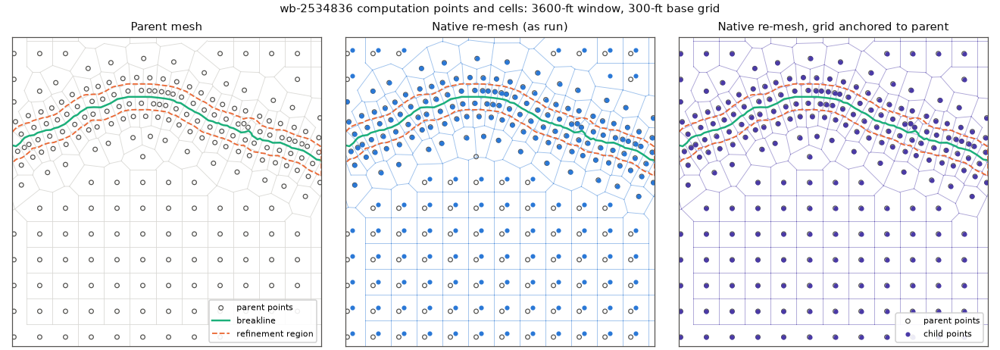
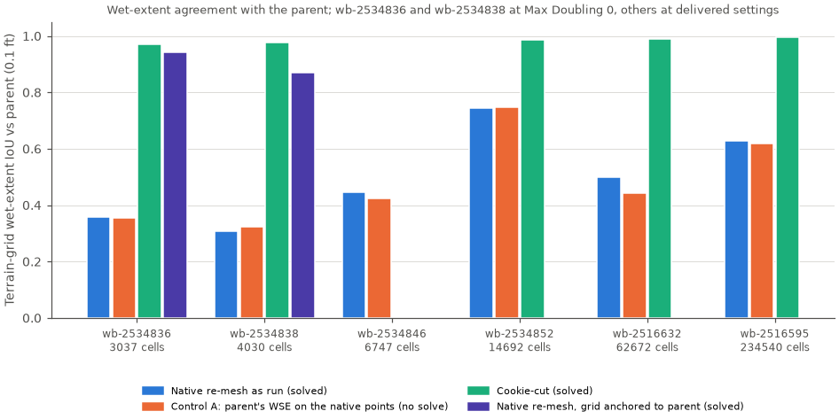

# Mesh grid anchor

Status: **option (b) implemented as `GeomMesh.generate(grid_anchor=...)`; point-generation evidence on six child
areas and one public example; HEC-RAS geometry preprocessing checked on the public example**

Date: 2026-10-14

## Outcome

RAS Mapper lays a 2D flow area's regular (base) computation-point grid from the area's own bounding box. A child area
cut from a parent therefore re-meshes on a grid offset from the parent's by a sub-cell vector, even when the base
spacing, breaklines and refinement regions are the parent's. Across six rain-on-grid children of one 300 ft parent,
none of the regenerated base-grid points coincided with the parent's, and 43-58% of all cells moved.

HEC-RAS has no setting that moves the grid origin (option (a)). A small change in RAS Commander does (option (b)).
`GeomMesh.generate(grid_anchor=...)` lays the lattice through a point of the parent's lattice, using RAS Mapper's
own perimeter filter. That lattice replaces the area's points in memory. RAS Mapper's `RegenerateMeshPoints` then
runs with the area active but not regenerated, the call RAS Mapper's own breakline and refinement-region editors make.
RAS Mapper then adds the refinement-region points and enforces the breaklines on the anchored lattice. This replaces
the move-and-move-back workaround (option (c)). It gives the same interior points as option (c), needs no perimeter
refill, and leaves no translated copies.

| Child (parent cells inside) | As-run native | (a) `Shift dx/dy` | (b) anchored | (c) move and move back | (b) + breakline rule |
|---|---|---|---|---|---|
| wb-2534836 (3,059) | 0.451 / 0.488 | 0.451 / 0.488 | **0.984 / 0.991** | 0.977 / 0.991 | 0.990 / 0.995 |
| wb-2534838 (4,087) | 0.419 / 0.446 | 0.419 / 0.446 | **0.837 / 0.864** | 0.835 / 0.864 | 0.902 / 0.916 |
| wb-2534846 (6,800) | 0.518 / 0.538 | 0.518 / 0.538 | **0.982 / 0.985** | 0.980 / 0.985 | no line affected |
| wb-2534852 (14,677) | 0.575 / 0.590 | 0.575 / 0.590 | **0.969 / 0.969** | 0.969 / 0.969 | not run |
| wb-2516632 (62,830) | 0.527 / 0.535 | 0.527 / 0.535 | **0.963 / 0.963** | 0.960 / 0.963 | not run |
| wb-2516595 (234,714) | 0.559 / 0.565 | 0.559 / 0.565 | **0.969 / 0.971** | 0.969 / 0.971 | not run |

Each cell gives the share of the child's computation points identical to a parent cell center (within 0.01 ft),
overall / interior. Interior excludes points within one base cell (300 ft) of the child perimeter. Point generation
only: RAS Mapper 6.6 through RAS Commander, no hydraulic solve. Script: `scripts/probe_grid_anchor.py`; numbers:
`results/probe_summary.json`. The child counts are the parent's cells inside each child perimeter, not the child's.

## The problem: where HEC-RAS places the base grid

### What RAS Mapper does

`RasMapperLib.EditLayers.PointGenerator.GeneratePointsInternal` (decompiled from HEC-RAS 6.5, 6.6, 6.7 Beta 5 and
7.0.1, identical in all four) places the first point at

```text
x0 = extent.Left + 0.5 * Spacing dx
y0 = extent.Top  - 0.5 * Spacing dy
```

where `extent` is the bounding box of the polygon being filled. It then steps `Spacing dx` to the right and
`Spacing dy` down, for `ceil(width / dx)` columns and `ceil(height / dy)` rows. A point is kept when the polygon's
development TIN contains it and it is farther than `0.25 * max(dx, dy) - 0.0001` from the polygon edge
(`GetCellSizeDistanceBuffer`). The same routine fills each refinement region from the region's own extent.

`RegenerateMeshPoints` runs, in order:

1. the base grid for every area in `regeneratePerims` (after deleting that area's points);
2. the refinement-region points for every active area and region (after deleting points inside the region);
3. `EnforceBreaklines`: discretize each breakline, delete points around it, and add the near/far rows on both sides.

### Evidence

- The base-grid phase of the parent and of all six as-run children equals `(min x + dx/2, max y - dy/2)` of each
  area's perimeter to 0.001 ft (packet JE, `grid_phase.json`). Child phases differ from the parent's by up to 142 ft
  in each axis on a 300 ft grid; wb-2534836 is offset by 57.5 ft and 43.3 ft.
- `figures/fig1_grid_phase_wb-2534836.png` shows the parent mesh, the as-run child (every base point shifted) and the
  anchored child (base points on the parent's) in a 3,600 ft window.



## Why it matters

- **Rain-on-grid shallow-depth mapping.** On steep terrain with thin sheet flow, a cell-flat depth map wets only the
  lowest terrain pixels of each cell. Moving the cells moves which pixels are wet. In the six children, the
  terrain-grid wet-extent IoU against the parent was 0.30-0.75 for the as-run native re-mesh. The cell-level IoU was
  0.995-1.0, and the outlet hydrographs matched. Moving the parent's own result onto the child's points without
  solving ("control A") scored the same IoU within 0.06, so the gap is the mesh, not the hydraulics. With the grid
  anchored, the two children that were solved rose from 0.36 to 0.94 and from 0.31 to 0.87.
  ([fig3](figures/fig3_iou_by_child.png), [fig2](figures/fig2_wet_extent_wb-2534836.png).)
- **Ensembles re-meshed from one parent.** Nested or neighboring child models, scenario variants and Monte Carlo
  members cut from one parent can share the parent's lattice. Their interior cells then coincide with each other and
  with the parent, and differences between members reflect the change under study rather than grid phase.
- **Cell-level versus terrain-grid extent.** Without an anchor, terrain-grid extent comparisons between parent and
  child mostly measure the mesh partition. Report the cell-level extent alongside it.



## Option (c): move and move back (the workaround)

Packet JE anchored the grid without changing RAS Mapper's generator. Its wrapper replaced
`GeomMesh._generate_seeds_via_net` at run time:

1. **Translation vector.** With the parent's phase `t = ((parent min x + dx/2) mod dx, (parent max y - dy/2) mod dy)`
   and the child's bounding box, `a = (t_x - (child min x + dx/2)) mod dx` and likewise for y. Take the short way
   round, `v = a - dx` when `a > dx/2`, so each component lies in `(-dx/2, dx/2]`.
2. **Move the features by -v.** On a throw-away copy of the compiled child geometry HDF, subtract `v` from the
   breakline points (`Geometry/2D Flow Area Break Lines/Polyline Points`), the refinement-region points
   (`.../Refinement Regions/Polygon Points`) and the structure centerlines (`Geometry/Structures/Centerline Points`).
   The perimeter is not moved, so the base grid keeps the child's own phase.
3. **Regenerate.** Run RAS Mapper's `RegenerateMeshPoints` on the copy. Relative to the moved features, the base grid
   now has the parent's phase.
4. **Move every point back by +v.** The breakline and region points land back on their features; the base grid lands
   on the parent's lattice. Delete the copy.
5. **Refill.** The lattice was generated over the unmoved perimeter, so a strip less than one cell wide along the
   perimeter has no base points after step 4. Add the parent-lattice points in that strip that are inside the child
   and more than half a base cell from any feature point.
6. **Continue.** `GeomMesh.generate` removes points outside the perimeter, runs its repair loop and writes the points
   to the geometry text. HEC-RAS preprocessing builds the cells.
7. **Verify.** Count the child's points within 0.01 ft of a parent cell center, overall and outside a one-cell
   perimeter band, and check the solve against the parent (outlet hydrograph, wet extent).

Results (packet JE, two solves on the cluster): 97.7% and 83.5% of points identical to the parent. Terrain-grid IoU
rose from 0.36 to 0.94 and from 0.31 to 0.87 against 0.97 and 0.98 for the cookie-cut child at the same settings.
Outlet Nash-Sutcliffe efficiency was 0.9999 and 0.9997.

Limits:

- **Perimeter band.** Breakline points near the edge are generated against a perimeter displaced by `v` relative to
  the features, and the refill is a heuristic. On wb-2534836, 64% of the remaining changed cells were in the band.
- **Breaklines clipped at the perimeter.** On wb-2534838, four parent breaklines crossed the child perimeter, and one
  road was cut into five pieces. 406 of the 499 interior changed points lay within 300 ft of those lines. Each piece
  is discretized from its own start, so its rows no longer line up with the parent's.
- **A translated copy of the geometry** must be written and deleted for every regeneration, and the wrapper patches a
  private function.

## Option (a): a native origin setting does not exist

- **`Shift dx` / `Shift dy`.** `MeshPolygonLayer` defines managed columns "Cell Shift DX/DY", stored as `Shift dx` and
  `Shift dy` in `Geometry/2D Flow Areas/Attributes`. RAS Mapper reads and writes them, but nothing in RasMapperLib
  6.6 uses them. The only consumer is a hidden, disabled text box in the 2D-area editor (`D2Editor.UpdateShift`),
  whose value is never passed on. Setting them to the needed shift left the points unchanged on all six children (see
  the table above) and in 31 candidate shifts in packet JE's cluster job.
- **Other attributes.** `GeneratePointsInternal` reads only the polygon, `Spacing dx`, `Spacing dy` and
  "Generate as Hexagon"; the last is reset to false whenever the HDF is loaded. There is no origin or extent
  attribute in the HDF.
- **Geometry text.** `Storage Area Point Generation Data=` carries two leading fields that RAS Commander writes empty,
  then the spacing. RAS Mapper's point generator reads the HDF, not the text.
- **RAS Mapper versus the geometry preprocessor.** The 2D-area editor's "Generate Computation Points" calls
  `RegenerateMeshPoints` for that area (`D2Editor.ComputePoints`). The geometry preprocessor (`Ras.exe`) generates no
  lattice: it reads the explicit points from `Storage Area 2D Points=` in the geometry text and builds the cells
  around them. RAS Commander's `generate` writes those points. The anchor therefore only has to be applied where the
  points are generated.
- **Perimeter edits.** Editing the perimeter in the HDF only (a bounding rectangle, or a spike reaching the parent's
  corner) made `RegenerateMeshPoints` return the stored points unchanged in packet JE's probe. The method swallows
  its own exceptions (see "Found along the way").

## Option (b): anchored lattice, RAS Mapper enforcement (implemented)

### How it works

1. `GeomMesh.get_grid_anchor(parent_geometry_hdf, mesh_name)` reads the parent's stored perimeter and spacing with
   h5py and returns a `GridAnchor` at `(min x + dx/2, max y - dy/2)`: the parent's first grid point.
2. `GeomMesh.generate(..., grid_anchor=anchor)` loads the child's compiled geometry in RasMapperLib as usual. For the
   target area it builds the lattice `x = anchor.x + k dx`, `y = anchor.y - m dy` over the area's extent. It keeps the
   points RAS Mapper itself would keep: development-TIN contains the point and the point is farther than
   `GetCellSizeDistanceBuffer(dx, dy)` from the perimeter (`PointCloseToPerimeter`).
3. The area's existing points are replaced in memory by that lattice; points of other 2D areas are kept. Nothing is
   written to the HDF.
4. `RegenerateMeshPoints` runs with every breakline, SA/2D structure line and region active, the area in
   `activePerims`, and the area left out of `regeneratePerims`. RAS Mapper's own breakline and region editors make
   this call (`BreaklineEditor`, `MeshRegionEditor`: `regeneratePerims = new int[0]`). RAS Mapper adds the
   refinement-region points and enforces the breaklines on the anchored lattice, exactly as it would on its own.
5. The result continues through `generate`'s outside-point removal, repair loop and text writing unchanged.
   `MeshResult.grid_anchor` records the anchor and the lattice and enforced point counts. `fixes_applied` gains
   `grid_anchor:lattice_phase_locked`.

### Checks

- **Control.** With the child's own anchor, the anchored path reproduced RAS Mapper's native regeneration exactly on
  all six children and on the public `BaldEagleCrkMulti2D` geometry 12. Same points, same count.
- **Parent anchor.** See the table under "Outcome". Option (b) matched option (c) on the interior on every child: the
  interior point sets were identical on five children and differed by three points on wb-2534838. It scored 0.05-0.7
  percentage points higher overall, because the perimeter band is generated against the true perimeter and needs no
  refill.
- **HEC-RAS preprocessing.** On `BaldEagleCrkMulti2D` geometry 02 (125 ft cells, 9 breakline and structure lines),
  `generate` with an anchor shifted by (46.25 ft, -26.25 ft) wrote 71,833 points. `GeomPreprocessor`
  (`Ras.exe`, geometry only) compiled 71,833 cells: 97.8% of the cell centers lie on the requested lattice and none on
  the bounding-box lattice. The remainder are the breakline rows.
- **Two 2D areas.** On geometry 11, anchoring one area moved that area's base points onto the requested lattice with
  its breakline rows. The other area kept RAS Mapper's own points.
- **Tests.** `tests/test_geom_mesh_grid_anchor.py`: the anchor record, reading it from an HDF, input checks and the
  crossing rule (unit tests). It also has an opt-in native test (Windows, HEC-RAS 6.6,
  `RAS_COMMANDER_RUN_HECRAS_INTEGRATION=1`) covering the control, a shifted anchor, two areas and end-to-end
  `generate`. `tests/test_breakout_feature_handoff.py` checks that `RasBreakout2D` passes the parent's anchor to every
  remesh.

### Limits

- The anchor fixes the base grid only. A refinement region's grid comes from the region's own extent. Pass parent
  regions whole (RAS Mapper clips their points to the perimeter) to keep their points. A region clipped to the child
  gets a new extent and new points. See "Carry refinement regions into a child area" in `docs/api/meshing.md`.
- Breaklines clipped by the child perimeter still start their rows at new places (see the breakline rule).
- The child's base spacing must equal the parent's. `generate` reports a mismatch as an error result.
- The evidence here is point identity and one preprocessing check. The hydraulic effect was measured with option (c)
  in packet JE's two solves; option (b) produces the same interior points.

## Breakline rule

Project engineer, 2026-10-14: "Breaklines that cross [the child perimeter] more than once should just be removed. They
will be close to a boundary and be a little bit different anyway."

`Breakout2DSpec(max_breakline_perimeter_crossings=1)` applies it. During `preflight`, a source breakline that crosses
the mesh trim boundary more than once is given action `drop` with reason `exceeds_child_perimeter_crossing_limit`.
The trim boundary is the child perimeter eroded by one base cell, the boundary `RasBreakout2D` clips breaklines to.
Crossings are counted as `2 x (inside runs) - (own endpoints inside)`: 0 wholly inside, 1 with one end outside, 2
passing through. A closed line counts two per inside run. `None` (default) keeps the current behavior of clipping
every line.

Point-generation results with the parent anchor (option (b)):

| Child | Lines removed (perimeter crossings; trim-boundary crossings) | Identical overall / interior, without the rule | With the rule |
|---|---|---|---|
| wb-2534838 | Road (100) (4; 4), Road (114) (2; 6) | 0.837 / 0.864 | 0.902 / 0.916 |
| wb-2534836 | Road (99) (2; 2), passes straight through | 0.984 / 0.991 | 0.990 / 0.995 |
| wb-2534846 | none; two streams cross once | 0.982 / 0.985 | unchanged |

On wb-2534838, 150 of the 291 remaining interior differences lie within one base cell of the removed roads. There the
parent has breakline rows and the child now has the plain lattice. The rule also removes lines that pass straight
through the child (two crossings). Use `max_breakline_perimeter_crossings=2` to keep those and drop only lines that
weave along the edge.

## API

Implemented in this branch:

```python
anchor = GeomMesh.get_grid_anchor(parent_hdf, mesh_name="Parent")   # GridAnchor(x, y, spacing_dx, spacing_dy, source)
result = GeomMesh.generate("02", mesh_name="Parent", ras_object=child, grid_anchor=anchor)
result.grid_anchor  # {"anchor": {...}, "lattice_points": ..., "area_points_after_enforcement": ..., ...}

spec = Breakout2DSpec(..., max_breakline_perimeter_crossings=1)
pre = RasBreakout2D.preflight(spec, ras_object=parent_project)
prep = RasBreakout2D.prepare_cloned_geometry(pre, clone, ras_object=child, anchor_grid_to_parent=True)
```

- `GridAnchor` (frozen): `x`, `y`, `spacing_dx`, `spacing_dy` in the geometry's CRS and units, `source`; `phase`;
  `to_dict()`.
- `generate(grid_anchor=)` also accepts an `(x, y)` pair, which takes the cell size as its spacing. A bad type raises
  `TypeError`. A spacing mismatch, or RAS Mapper silently skipping enforcement, returns an error result with the
  reason. There is no unanchored fallback.
- `RasBreakout2D.prepare_cloned_geometry(anchor_grid_to_parent=True)` reads the anchor from the preflight's source
  geometry HDF and passes it to every remesh, including the numeric containment retry. It requires `remesh=True`.

Not implemented (proposals):

- `GeomMesh.generate_all(grid_anchor=...)` with a per-area mapping.
- Anchoring clipped refinement-region grids to the parent region's lattice (the same injection with
  `activeRegions` empty).
- A translate-and-restore function (option (c)). It is not needed while option (b) works.

## Found along the way

- **Multi-area geometries do not regenerate in the native path.** A geometry HDF loads one multipoint feature per 2D
  area. `RegenerateMeshPoints` throws "Can't call this function with multiple multipoints" when there is more than
  one and swallows the exception, so `GeomMesh.generate` on a multi-area geometry silently keeps the stored points.
  `BaldEagleCrkMulti2D` geometry 11 returned exactly the stored 3,359 and 1,066 points. The anchored path merges the
  points into one feature first, so it is not affected. The native path is unchanged here and should be fixed
  separately.
- **HDF table rewrites need the original layout.** RAS Mapper reads `Geometry/2D Flow Area Break Lines` tables as empty
  when they are rewritten as contiguous datasets without their attributes. The originals are chunked and
  gzip-compressed, and `Polyline Info` carries `Feature Type`. Packet JE's "whole parent breaklines" probe
  (identity 0.76-0.85) rewrote these tables with plain `create_dataset`. It probably ran with no breaklines, so treat
  that result as unverified.
- `RegenerateMeshPoints` swallows all exceptions. The anchored path raises when the enforced points equal the lattice
  while a breakline, structure line or region reaches the area.

## Files

- `scripts/probe_grid_anchor.py`: options (a), (b) with control, and (c) for one child against its parent.
- `results/probe_summary.json`: per-child metrics for the table above (no model paths).
- `results/breakline_rule.json`: crossing counts and metrics for the breakline rule.
- `figures/`: copied from packet JE (fig1 grid phase, fig2 wet extent, fig3 IoU by child).
